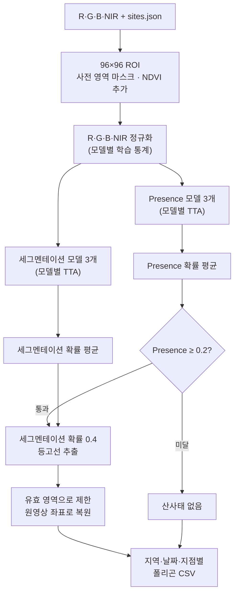
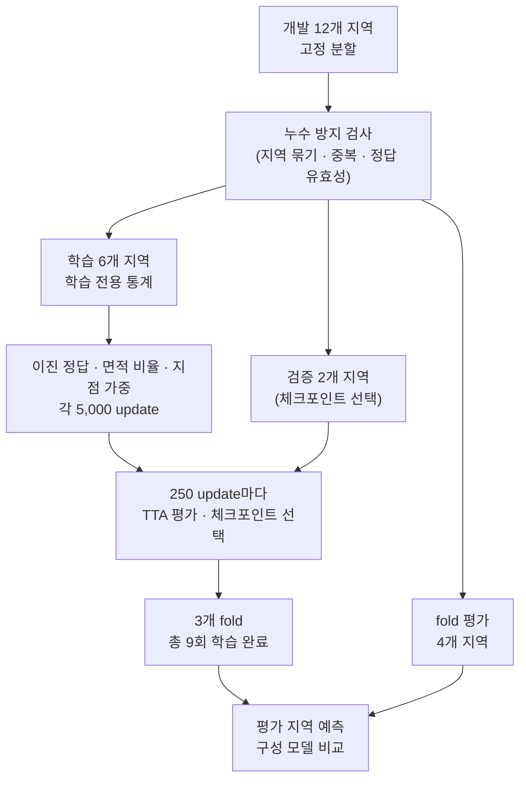

# Landslide Detection 2026

[**2026 국립공원 위성 모니터링 AI 챌린지 산사태 탐지 부문**](https://aifactory.space/ko/competitions/9305) 참가 솔루션과 주요 실험을 정리한 저장소다. R·G·B·NIR 위성영상과 사전 영역을 입력받아 지점별 산사태 유무와 경계를 예측하고, 지역·날짜·지점별 폴리곤 CSV를 출력한다. 지점은 한 지역 안에서 산사태 여부를 판정하는 개별 장소로, 대회에서는 '개소'(`site_id`)라고 부른다.

최종 솔루션은 **세그멘테이션 모델과 Presence(산사태 유무 판정) 모델을 따로 두는 앙상블**이다. 세그멘테이션에는 픽셀별 정답 면적 비율로 학습한 모델 3개를, Presence에는 이진 정답으로 학습한 모델 3개를 사용한다.

| 항목 | 요약 |
|---|---|
| Private | **12위 / 81팀 · 0.7051403543** |
| Public | 29위 · 0.7244646681 |

[솔루션과 선택 근거](#최종-솔루션) · [주요 실험](docs/experiments.md) · [전체 결과](docs/results.md) · [학습·추론 절차](docs/reproduction.md)

## 빠른 시작

모든 명령은 저장소 루트에서 실행한다. Python 3.12 환경에 의존성을 설치하면 외부 데이터나 가중치 없이 합성 데이터 테스트를 실행할 수 있다.

```bash
python3.12 -m venv .venv
source .venv/bin/activate
python -m pip install -e .
```

```bash
PYTHONPATH=src python -m unittest discover -s tests/integration -v
```

실제 학습에는 주최 측이 제공한 데이터가 필요하다.

## 데이터와 검증 설정

예측 단위는 **지역·날짜·지점 조합**이다.

| 구분 | 전체 | 개발 | Holdout |
|---|---:|---:|---:|
| 지역 | 15 | 12 | 3 |
| 지점 | 62 | 48 | 14 |
| 영상 수 (지역별 합계, 고유 날짜 수 아님) | 345 | 288 | 57 |
| 지역·날짜·지점 조합 | 1,691 | 1,348 | 343 |
| 양성 | 642 | 522 | 120 |
| 음성 | 959 | 760 | 199 |
| 라벨 없음 | 90 | 66 | 24 |
| 양성 중 면적 10픽셀² 미만 | 169 | 140 | 29 |

[고정 분할](configs/splits/fixed-group-holdout-v1-6f2d58d1a68c.json)에 따라 개발 12개 지역을 3개 fold로 나눈다. 각 fold는 **학습 6개·검증 2개·평가 4개 지역**으로 구성하며, 검증 지역은 체크포인트 선택에, 평가 지역은 fold별 최종 평가에 쓴다.

분할 전에는 같은 지역의 날짜와 지점을 한 묶음으로 두고, 서로 다른 지역에 동일한 영상이 있으면 그 지역들도 함께 묶어 누수를 막았다. 표본 키·영상 중복, 라벨 누락, 정답 도형의 유효성도 점검했다. 정확히 같은 영상 그룹은 없었고 자기 교차하는 정답 도형은 3개였다. 서로 다른 지역의 부분적인 지리 중첩까지는 확인하지 않았다.

## 최종 솔루션

### 입력과 추론

R·G·B·NIR 값을 10,000으로 나누고 사전 영역을 중심으로 96×96 ROI를 잘라낸다. 여기에 사전 영역 마스크와 NDVI를 채널로 더해 6채널 입력을 만든다. 정규화는 R·G·B·NIR에만 모델별 학습 통계로 밴드별 z-score를 적용하고, 마스크와 NDVI는 그대로 둔다.

모든 모델은 외부 사전학습 가중치 없이 대회 데이터로만 학습한 `SmallUNet`이다. 세그멘테이션 출력과 별도로 Presence 출력 헤드를 가지며, 이 헤드는 가장 깊은 128채널 특징을 공간 평균한 뒤 선형층 하나로 값을 내고 추론 때 0~1 확률로 바꾼다. 추론 시에는 0°·90°·180°·270° 회전과 각 회전의 반사를 조합한 8개 변환의 예측 확률을 평균한다(이하 TTA). 세그멘테이션 확률은 원래 방향으로 되돌려 평균하고, Presence 확률도 같은 변환들로 평균한다.

세그멘테이션과 Presence는 각각 모델 3개의 TTA 확률을 동일한 비중으로 평균한다. Presence 확률이 0.2 미만이면 산사태가 없다고 판정해 폴리곤을 출력하지 않고, 0.2 이상이면 세그멘테이션 확률 0.4의 등고선에서 폴리곤을 추출하며, 영상 밖 채움 영역과 무효 화소에 해당하는 부분은 유효 영역과 교차시켜 제외한다. 이 필터는 산사태가 없는 표본의 오탐을 줄이지만, 산사태가 있는 표본을 걸러내면 미탐이 된다.



6채널 SmallUNet의 파라미터는 모델당 **487,858개**다. 최종 구성은 ROI 하나당 모델 6개×변환 8개, 총 48회의 순전파를 수행한다. 지점당 추론 시간과 최대 메모리는 측정값이 없다. 전처리·모델·폴리곤 변환의 세부 사항은 [구현 세부 사항](docs/reproduction.md#구현-세부-사항)을 참고한다.

### 학습과 체크포인트 선택

이진 정답 모델의 손실은 세그멘테이션 `0.5×BCE + 0.5×Dice`에 Presence BCE를 더한 값이다. Dice는 유효한 양성 ROI에만 적용하며, 배치에 해당 ROI가 없으면 세그멘테이션 손실은 BCE만 쓴다.

면적 비율 모델은 세그멘테이션 BCE의 target만 **각 픽셀이 정답 폴리곤과 겹치는 면적 비율**로 바꾼 모델이다. Dice와 Presence의 target은 이진 정답 그대로다. 양성 날짜가 적은 지점의 Dice 비중을 높인 모델도 실험했지만 최종 앙상블에는 넣지 않았다.

모든 모델은 Adam(lr 0.001), batch size 32, 5,000 update로 학습하고 무작위 회전·반사 증강을 적용한다. 전역 seed는 42로 고정했고 모델·fold별로 다른 시드를 쓰지 않았다. 250 update마다 검증 지역을 TTA와 최종 후처리까지 적용해 평가하고, [참고 총점](#평가-기준)이 처음으로 최고값을 기록한 체크포인트를 저장한다.



세 가지 학습 방식(이진 정답·면적 비율·지점 가중)을 3개 fold에서 학습해 총 9회, 45,000 update를 마쳤다. 이 중 면적 비율 모델 3개와 이진 정답 모델 3개가 최종 앙상블을 이룬다. 당시 학습 환경(MPS)에서 9회 학습과 지정 평가에 5,435.781초(약 90.6분)가 걸렸으며, 데이터 준비·테스트·보고서 작성 시간은 포함하지 않는다. 세부 내용은 [학습 명세](docs/reproduction.md#손실과-체크포인트-선택)를 참고한다.

## 주요 실험과 선택 근거

### 평가 기준

Presence(대회 표기: 존재판정)는 최종 폴리곤 유무에 대한 양성·음성 macro-F1이다. Shape(형상)는 면적 10픽셀² 이상인 양성의 IoU를 지점 내 날짜별로 평균한 뒤 지점 간 균등 평균한 값이다. 라벨 없음은 평가에서 제외하고, 10픽셀² 미만 양성은 Presence에만 포함한다.

대회 [평가산식](https://aifactory.space/ko/competitions/9305/data)은 `Total = 0.6×Presence + 0.4×Shape`다. 로컬 자료에는 유효하지 않은 양성 정답 폴리곤이 있어 전체 Shape와 Total은 계산할 수 없다(NA). 그래서 계산 가능한 부분집합의 Shape 진단 점수를 써서 **참고 총점 = 0.6×Presence + 0.4×Shape 진단**으로 비교했다. NA는 0으로 채우지 않았다.

| 로컬 평가 | 정답이 있는 표본 | Shape 진단 대상 (날짜·지점) | 유효하지 않은 정답 |
|---|---:|---|---:|
| Holdout | 319건 | 89건 (9개 지점) | 2건 |
| 3개 fold 평가 합산 | 1,282건 | 381건 (33개 지점) | 1건 |

참고 총점은 플랫폼 점수와 직접 비교할 수 없다. 최종 6개 모델 앙상블 자체의 독립 OOF 평가는 없으며, 구성 모델의 OOF로 대신할 수 없다. 자세한 조건은 [평가 단위와 산식](docs/results.md#평가-단위와-산식)에 있다.

### 주요 비교

최종 솔루션에 영향을 준 여섯 가지 비교다. **행마다 평가 데이터와 조건이 다르므로 개선 폭을 합산하거나 하나의 누적 실험으로 읽으면 안 된다.**

| 바꾼 조건 | 평가 데이터 · 지표 | 변경 전 → 변경 후 | 변화 |
|---|---|---:|---:|
| 세그멘테이션 손실: BCE → BCE+Dice | Holdout 319건 · 참고 총점(근삿값) | 0.499914 → 0.730950 | +0.231036 |
| 체크포인트 선택: 일반 BCE 최소 → TTA 참고 총점 최대 | fold 평가 1,282건 · 참고 총점 | 0.535813 → 0.697682 | +0.161869 |
| 세그멘테이션 정답: 이진 → 픽셀별 면적 비율 | fold 평가 1,282건 · 참고 총점 | 0.697682 → 0.707702 | +0.010020 |
| Dice: 기본 → 지점 가중 | fold 평가 1,282건 · 참고 총점 | 0.697682 → 0.692659 | −0.005023 |
| 모델 구성: 공유 → 세그멘테이션·Presence 분리 | Holdout 319건 · 참고 총점 | 0.758033 → 0.771993 | +0.013959 |
| 폴리곤 변환: 픽셀 사각형 합집합 → 확률 등고선 | 대회 Public · Total | 0.707825 → 0.717962 | +0.010137 |

BCE와 BCE+Dice는 일반 추론, 임계값 0.5/0.5로 비교했으며, 이 행의 참고 총점은 반올림된 Presence·Shape 진단값으로 계산한 근삿값이다. 체크포인트 선택은 같은 학습 궤적에서 선택 기준만 바꾼 비교이며 TTA만의 효과가 아니다. 후처리 비교는 같은 가중치, 8개 변환 평균, 임계값 0.2/0.4를 사용했다. 픽셀 사각형 합집합은 확률이 기준 이상인 픽셀을 각각 작은 사각형으로 보고, 맞닿은 사각형을 합쳐 도형을 만드는 방식이다. 수치는 당시 실험 기록이고 소수 여섯째 자리까지 표시했으며, 변화는 원 기록의 차이를 따른다. 재학습 결과가 같은지는 별도로 확인해야 하며, 정확한 조건은 [주요 실험 기록](docs/experiments.md)에 있다.

임계값은 처음에 존재·마스크 모두 0.5였다. 저장된 예측 확률로 비교한 뒤 존재 기준을 0.3에서 0.2로 낮춘 제출의 Public 점수가 올라 0.2/0.4를 채택했다. 반복 사용한 로컬 검증을 바탕으로 정한 값이므로 보편적인 최적값은 아니다.

세그멘테이션 정답은 면적 비율을 채택했다. 지점 가중 Dice는 작은 양성의 미탐을 41건에서 35건으로 줄였지만 오탐이 114건에서 141건으로 늘고 참고 총점도 낮아져 최종 구성에서 제외했다. NDVI 추가, TTA, 모델 수 증가의 효과는 위 수치로 분리해 주장하지 않는다.

### 역할 분리 전후

같은 holdout에서 두 구성을 비교했다. 분리 전에는 세그멘테이션과 Presence에 같은 모델 3개를 사용했고, 최종 구성은 Presence에 별도의 이진 정답 모델 3개를 사용한다.

| 핵심 지표 | 역할 분리 전 | 최종 모델 |
|---|---:|---:|
| Presence macro-F1 | 0.923561 | 0.943320 |
| Shape 진단 | 0.509742 | 0.515002 |
| 참고 총점 | 0.758033 | 0.771993 |
| 음성 199건 중 오탐 | 13 | 9 |
| 양성 120건 중 미탐 | 10 | 8 |

경계 예측 모델은 그대로 두고 존재 판정만 이진 정답 모델로 맡기자 참고 총점이 0.013959 올랐고 오탐과 미탐이 함께 줄었다. 작은 산사태의 미탐 6건은 그대로였다.

SegFormer·HRNet 등 다른 모델과 후반 실험은 [비교 요약](docs/experiments.md#다른-모델과-후반-실험)에 정리했다.

## 오류 분석

아래 그림의 S029·S030·S032·E121은 내부 실험 ID다.


*역할 분리 전 구성(S029)과 최종 앙상블(S030)의 오류 비교.*

후속 구성에서는 개발 12개 지역 전체로 두 역할의 모델을 다시 학습했다. 로컬 참고 총점은 올랐지만 Public·Private 점수는 오히려 낮아졌다. 학습 지역, 정규화 통계, 학습량, 모델 수가 함께 바뀌어 하락 원인을 하나로 특정할 수 없다. 반복 사용한 holdout의 개선이 공개 평가 데이터로 이어지지 않았을 가능성이 있으며, 공식 Presence·Shape 성분 점수는 확인하지 못했다. 상세 수치와 집계 그래프는 [전체 결과](docs/results.md)에 있다.


*최종 앙상블(S030)과 개발 12개 지역 전체로 재학습한 구성(S032)의 비교.*

아래 네 사례는 최종 모델(S030)과, fold별 학습 지역을 6개에서 8개로 늘린 비교 모델(E121)의 저장 예측을 비교한 것이다. 이 모델도 정규화·학습량·체크포인트 선택 방식이 함께 바뀌어 학습 지역 수만의 효과로 볼 수 없다.

그림의 위 행은 **RGB 전체 ROI → 최종 모델의 세그멘테이션 확률 → 비교 모델의 세그멘테이션 확률**, 아래 행은 **NDVI 확대 → 최종 모델의 최종 예측 → 비교 모델의 최종 예측** 순서다. 노랑은 정답, 파랑은 사전 영역, 회색은 Presence 필터 적용 전 폴리곤, 초록은 최종 폴리곤이다. 색상 막대는 픽셀별 세그멘테이션 확률이고 제목의 `p`는 Presence 확률이며, 축은 원영상 픽셀 좌표다.

### 최종 모델만 검출한 산사태

최종 모델은 Presence 확률 0.9908로 산사태를 검출했고 최종 폴리곤 IoU는 0.5996이다. 정답 밖에 작은 조각이 남았다. 비교 모델은 세그멘테이션 예측이 정답과 겹쳤지만 Presence 확률이 0.1294로 임계값 0.2 미만이어서 산사태 없음으로 판정해 놓쳤다.


### 검출했지만 경계 대부분을 놓친 경우

최종 모델은 Presence 확률 0.3374로 임계값을 통과했지만 최종 폴리곤에는 정답의 작은 일부만 남아 IoU가 0.0751이다. 비교 모델은 같은 장면에서 IoU 0.4374로 더 넓게 포착했으나 바깥쪽 경계는 여전히 빠졌다.


### 작은 양성

최종 모델은 정답 면적 7.02555픽셀²의 작은 양성을 Presence 확률 0.3895로 검출했다. 비교 모델은 세그멘테이션 예측이 있었지만 Presence 확률 0.1918이 임계값 0.2에 못 미쳐 놓쳤다. 이 사례는 Presence에는 포함되지만 10픽셀² 미만이라 Shape에서는 제외되며, 그림의 IoU NA는 0점이 아니다.


### 음성 장면의 오탐

두 모델 모두 Presence 필터 적용 전에는 폴리곤이 있었다. 최종 모델은 Presence 확률 0.3607로 폴리곤을 남겨 오탐했고, 비교 모델은 0.1409로 임계값 미만이어서 올바르게 산사태 없음으로 판정했다. 양성 정답이 없는 장면이라 Shape IoU는 NA다. 앞의 미탐 사례와 함께 보면 같은 Presence 임계값이 오탐을 줄이는 대신 실제 산사태를 놓치게 하기도 한다.


2026-09-20에 대회 제공 영상·정답과 저장 예측을 비교했다. 반복 사용한 개발 holdout에서 사후에 고른 사례이므로 전체 성공·실패 빈도나 Public·Private 결과를 대표하지 않는다.

## 전체 학습과 추론

### 추론

```bash
python examples/make_inputs.py --output inputs
# weights/model.pt에 최종 모델 가중치를 둔 뒤 실행
python scripts/run_inference.py \
  --input inputs --checkpoint weights/model.pt \
  --output outputs/predictions.csv --device cpu
```

최종 모델 가중치(`.pt`)는 Git 추적 대상에서 제외되어 이 저장소에 포함되어 있지 않다.

실제 입력도 같은 구조를 따른다. 영상은 **H×W×4 NumPy 배열(R·G·B·NIR 순서)**이고 날짜는 파일명으로 지정한다. `sites.json`은 `site_id`와 `prior_polygon`(사전 영역 좌표)을 담은 목록이다.

```text
inputs/
└── synthetic_region/
    ├── sites.json         # site_id와 prior_polygon
    └── bands/
        └── 20200101.npy   # H×W×4, R·G·B·NIR
```

### 개발 환경

| 항목 | 당시 환경 |
|---|---|
| 하드웨어 | Apple M5 · 24GB |
| OS | macOS 26.6.2 · arm64 |
| Python | 3.12.13 |
| PyTorch | 2.14.0 |

## 저장소 구조

```text
src/              전처리·모델·학습·평가·후처리·추론
scripts/          추론·학습·가중치 조립·결과 그림 실행 스크립트
configs/          최종 추론 설정, 고정 분할·학습 통계
examples/         합성 입력 생성기, CSV 형식 예시
tests/            합성 입력·데이터 분리·추론 평균·저장·실행 명령 테스트
docs/             주요 실험·상세 결과·재현 안내, 예측 사례·집계 그래프
pyproject.toml    Python 버전 조건, 패키지 버전 고정
```
