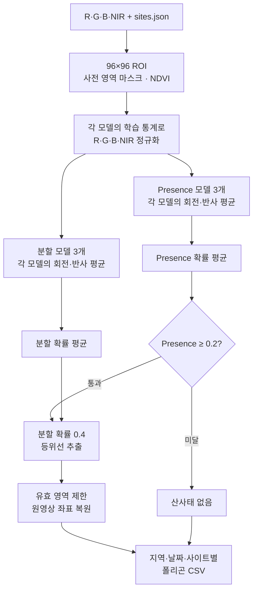
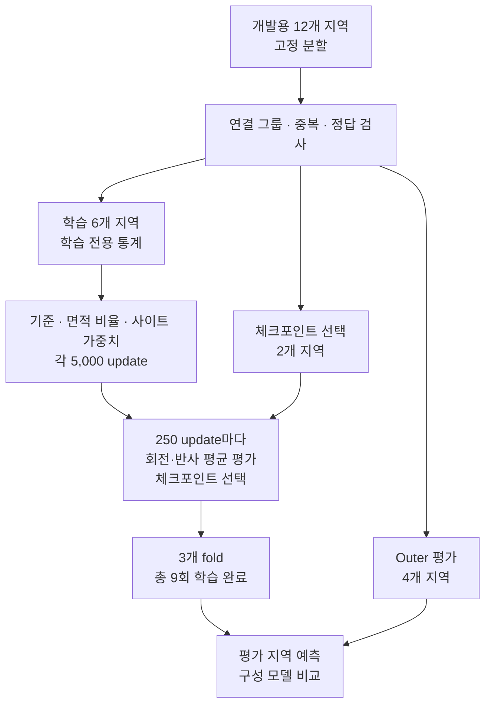
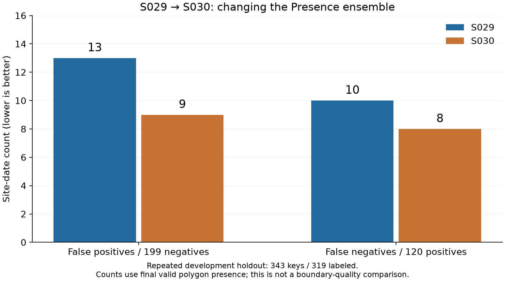
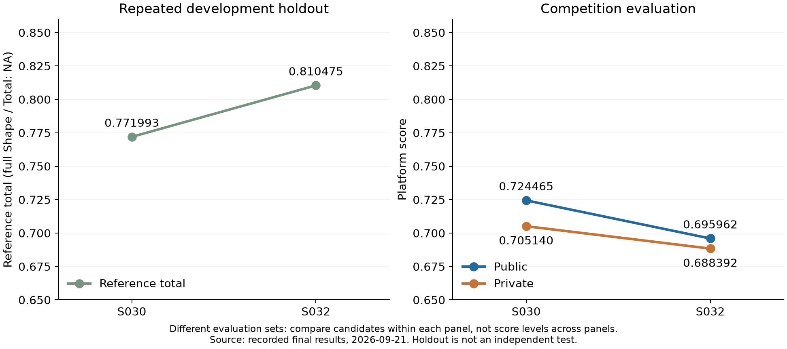
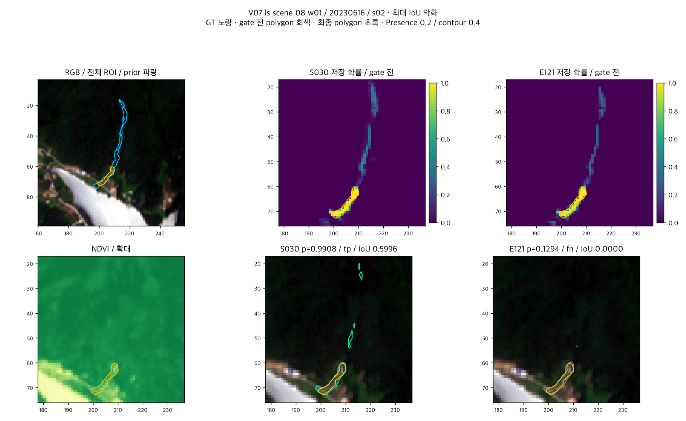
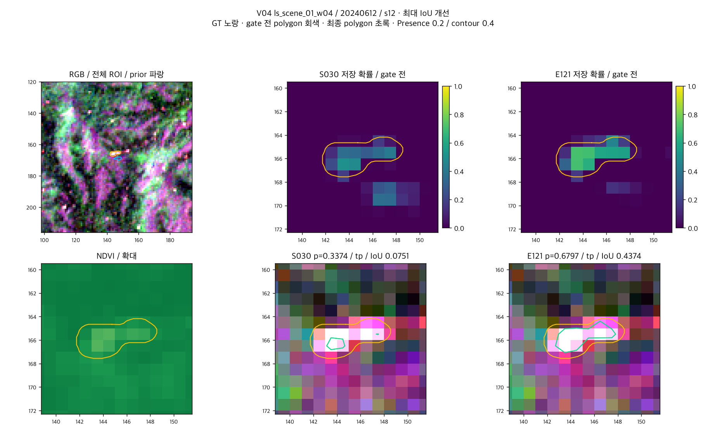
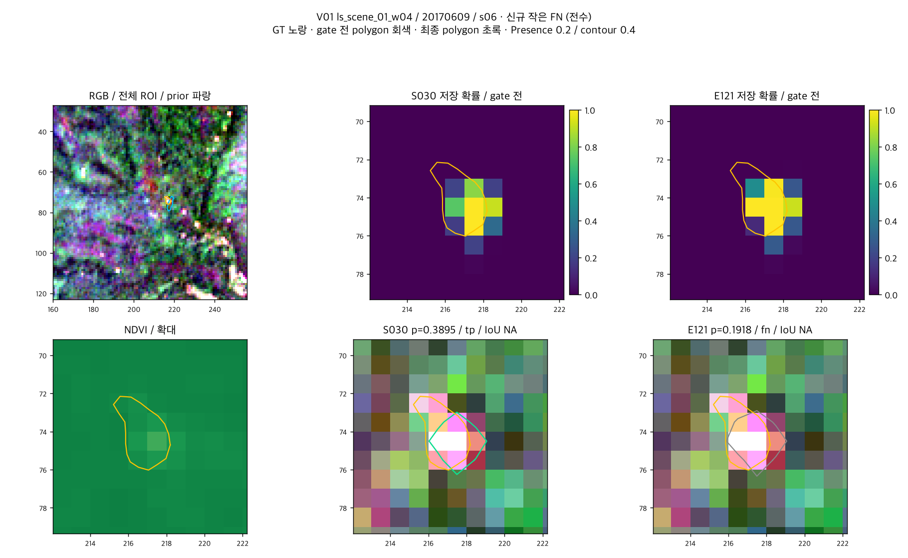
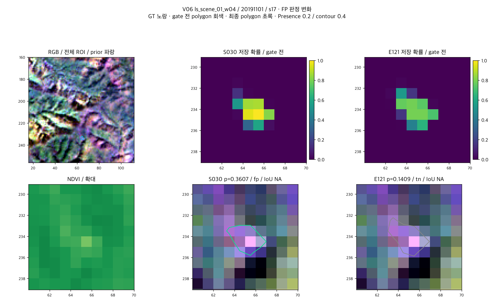

# Landslide Detection 2026

[**2026 국립공원 위성 모니터링 AI 챌린지 산사태 탐지 부문**](https://aifactory.space/ko/competitions/9305)의 참가 해법과 주요 실험을 정리했다. R·G·B·NIR 위성영상과 사전 영역을 입력받아 사이트별 산사태 존재 여부와 경계를 예측하고 지역·날짜·사이트별 폴리곤 CSV를 출력한다.

최종 해법은 **분할과 Presence에 서로 다른 모델을 사용하는 앙상블**이다. 픽셀별 정답 면적 비율로 학습한 모델 3개를 분할에, 이진 정답으로 학습한 기준 모델 3개를 Presence에 사용한다.

| 항목 | 요약 |
|---|---|
| 최종 Private | **12위 / 81팀 · 0.7051403543** |
| Public | 29위 · 0.7244646681 |
| 핵심 선택 | 분할과 Presence에 서로 다른 모델 사용 |
| 바로 실행 가능 | 데이터·가중치가 필요 없는 합성 검사 |
| 실제 학습·추론 | 학습에는 원자료, 추론에는 입력 영상·사전 영역과 학습된 가중치 필요 |

성적은 대회 참가자가 2026-09-21에 기록한 최종 결과다. 저장소에는 학습·추론 코드, 고정 분할·설정과 주요 실험을 포함하며 원자료와 학습된 가중치는 제공하지 않는다.

[해법과 선택 근거](#최종-해법) · [주요 실험](docs/experiments.md) · [전체 결과](docs/results.md) · [학습·추론 절차](docs/reproduction.md) · [이용 조건](#한계와-이용-조건)

## 바로 실행하기

모든 명령은 저장소 루트에서 실행한다. Python 3.12 환경에 의존성을 설치한 뒤, 외부 데이터·가중치 없이 합성 검사를 실행할 수 있다.

```bash
python3.12 -m venv .venv
source .venv/bin/activate
python -m pip install -e .
```

```bash
PYTHONPATH=src python -m unittest discover -s tests/integration -v
```

합성 입력으로 전처리, 손실, 데이터 분할, 회전·반사 평균, 폴리곤 변환, 짧은 학습, 체크포인트 저장·복구와 CLI 연결을 검사한다. MPS 검사는 기본으로 건너뛴다. 실제 탐지 품질을 평가하는 검사는 아니다.

실제 학습에는 원자료가, 추론에는 입력 영상·사전 영역과 학습된 가중치가 필요하다. [전체 학습과 추론](#전체-학습과-추론)에 준비 방법과 명령을, [당시 환경과 검증 범위](#당시-환경과-검증-범위)에 확인 상태를 정리했다.

## 데이터와 검증 구성

대회 제공 자료의 예측 단위는 **지역·날짜·사이트 조합**이다. R·G·B·NIR에 사전 영역 마스크와 NDVI를 더한 6채널 96×96 ROI를 사용한다.

| 구분 | 전체 | 개발용 | Holdout |
|---|---:|---:|---:|
| 지역 | 15 | 12 | 3 |
| 사이트 | 62 | 48 | 14 |
| 지역별 영상 수의 합 | 345 | 288 | 57 |
| 지역·날짜·사이트 조합 | 1,691 | 1,348 | 343 |
| 양성 | 642 | 522 | 120 |
| 음성 | 959 | 760 | 199 |
| 미라벨 | 90 | 66 | 24 |
| 양성 중 면적 10픽셀² 미만 | 169 | 140 | 29 |

영상 수는 지역별 영상의 합계이며 고유 날짜 수가 아니다. [고정 분할](configs/splits/fixed-group-holdout-v1-6f2d58d1a68c.json)에 따라 개발용 12개 지역을 3개 fold로 나누고 각 fold에서 **학습 6개·체크포인트 선택 2개·outer 평가 4개 지역**을 사용한다. 별도 holdout 3개 지역은 학습에서 제외했지만 개발 중 반복 사용했다.

## 최종 해법

### 입력과 추론

R·G·B·NIR은 10,000으로 나누고 사전 영역 중심의 96×96 ROI를 사용한다. 여기에 사전 영역 마스크와 NDVI를 추가해 6채널 입력을 만든다. 각 모델의 학습 자료에서 구한 통계로 R·G·B·NIR만 밴드별 z-score 정규화하며 사전 영역 마스크와 NDVI에는 이 정규화를 적용하지 않는다.

모든 구성 모델은 `SmallUNet`이며 외부 사전학습 가중치 없이 대회 자료로 학습했다. 추론 시 0°·90°·180°·270° 회전과 각 회전의 반사를 조합한 **8개 변환의 예측 확률을 평균**한다. 분할 예측은 원래 방향으로 복원한 뒤 평균하고 Presence도 같은 변환들의 확률을 평균한다.

분할과 Presence는 각각 모델 3개의 확률을 같은 비중으로 평균한다. 각 모델의 확률은 회전·반사 평균을 마친 값이다. Presence 확률이 0.2보다 낮으면 **산사태 없음**으로 판정해 폴리곤을 출력하지 않는다. 임계값을 통과하면 분할 확률 0.4의 등위선으로 폴리곤을 추출한다.

이 판정은 산사태가 아닌 곳에 생긴 분할 예측을 걸러 오탐을 줄이기 위해 사용한다. 실제로 산사태가 없는 표본에서는 올바른 음성 예측이지만, 산사태가 있는 표본을 산사태 없음으로 판정하면 미탐으로 평가된다.



6채널 SmallUNet의 파라미터는 모델당 **487,858개**다. 최종 구성은 유효한 사이트·날짜 ROI 하나당 6개 모델에 8개 변환을 적용하므로 총 48회의 모델 순전파가 필요하다. 사이트당 추론 시간과 최대 메모리는 측정값을 제시할 수 없다. [모델·전처리·폴리곤 변환 상세](docs/reproduction.md#구현-세부-사항)를 참고한다.

### 학습과 체크포인트 선택

기준 모델의 손실은 **분할 `0.5×BCE + 0.5×Dice`에 Presence BCE를 더한 값**이다. Dice는 유효한 양성 ROI에만 적용하며 배치에 해당 ROI가 없으면 분할 손실은 BCE만 사용한다.

면적 비율 모델은 분할 BCE의 target을 **GT 폴리곤과 단위 픽셀의 교집합 면적 비율**로 바꾼다. Dice와 Presence의 target은 이진 정답을 유지한다. 양성 날짜가 적은 사이트의 Dice 기여도를 높이는 실험도 수행했지만 최종 앙상블에는 포함하지 않았다.

모든 모델은 **seed 42**, Adam, 학습률 0.001, batch size 32, 5,000 update로 학습하며 무작위 회전·반사 증강을 적용한다.

250 update마다 선택용 자료를 회전·반사 평균과 최종 후처리로 평가하고 [참고종합](#평가-기준)이 처음 최고가 된 체크포인트를 `best_d4.pt`로 저장한다. 회전·반사 평균 없이 계산한 검증 BCE 합이 처음 최저가 된 `best.pt`와 마지막 시점의 `last.pt`도 보관한다. Outer fold 결과는 체크포인트 선택에 쓰지 않는다.



비교 실험은 세 학습 방법×3개 fold로 총 9회·45,000 update를 마친 뒤 outer 평가를 수행한다. 최종 앙상블에는 이 중 면적 비율 모델 3개와 기준 모델 3개를 사용한다. 기록된 MPS 환경에서 **9회 학습과 지정 평가에 5,435.781초(약 90.6분)**가 걸렸다. 데이터 준비·합성 검사·보고서 작성은 포함하지 않은 시간이다. 세부 구현은 [학습 명세](docs/reproduction.md#손실과-체크포인트-선택)를 참고한다.

## 주요 실험과 선택 근거

### 평가 기준

Presence는 최종 유효 폴리곤의 존재 여부에 대한 양성·음성 macro-F1이다. Shape는 면적 10픽셀² 이상인 유효 양성의 IoU를 사이트 내 날짜별로 평균한 뒤 사이트별로 균등 평균한다. 미라벨은 평가에서 제외하며 작은 양성도 Presence에는 포함한다.

대회 산식은 `Total = 0.6×Presence + 0.4×Shape`다. 로컬에는 유효하지 않은 양성 GT가 있어 전체 Shape·Total을 **계산 불가(NA)**로 두고 계산 가능한 부분집합의 Shape 진단으로 **참고종합 = 0.6×Presence + 0.4×Shape 진단**을 구했다. NA를 0으로 채우지 않는다.

| 로컬 평가 | 정답이 있는 표본 | Shape 진단 대상 | 유효하지 않은 GT |
|---|---:|---|---:|
| Holdout | 319건 | 날짜·사이트 89건 / 9개 사이트 | 2건 |
| 3개 fold의 outer 합산 | 1,282건 | 날짜·사이트 381건 / 33개 사이트 | 1건 |

참고종합은 플랫폼 점수와 직접 비교할 수 없다. **최종 6개 모델 앙상블 자체의 독립 OOF는 없으며** 구성 모델의 OOF로 이를 대신할 수 없다. [평가 산식과 범위](docs/results.md#평가-단위와-산식)에 세부 조건을 정리했다.

### 주요 비교

최종 해법에 영향을 준 여섯 가지 비교다. **행마다 평가 자료와 조건이 다르므로 개선 폭을 더하거나 하나의 누적 실험으로 읽으면 안 된다.** 수치는 당시 실험에서 기록한 결과다. 재학습 결과의 일치는 별도로 확인해야 한다.

| 바꾼 조건 | 평가 자료·지표 | 변경 전 → 변경 후 | 변화 |
|---|---|---:|---:|
| 분할 BCE → BCE+Dice | Holdout 319건 · 참고종합(약) | 0.499914 → 0.730950 | +0.231036 |
| 일반 BCE 최소 → 회전·반사 평균의 참고종합 최대 시점 선택 | Outer 1,282건 · 참고종합 | 0.535813 → 0.697682 | +0.161869 |
| 이진 분할 정답 → 픽셀별 정답 면적 비율 | Outer 1,282건 · 참고종합 | 0.697682 → 0.707702 | +0.010020 |
| 기본 Dice → 사이트별 가중치 Dice | Outer 1,282건 · 참고종합 | 0.697682 → 0.692659 | −0.005023 |
| 분할·Presence 모델 공유 → 역할별 모델 분리 | Holdout 319건 · 참고종합 | 0.758033 → 0.771993 | +0.013959 |
| 픽셀 사각형 합집합 → 확률 등위선 | 대회 Public · Total | 0.707825 → 0.717962 | +0.010137 |

BCE와 BCE+Dice는 일반 추론·임계값 0.5/0.5에서 비교했다. 체크포인트 선택은 같은 학습 궤적에서 정책을 비교한 결과로, 회전·반사 평균만 추가한 효과가 아니다. 후처리 비교는 같은 가중치·8개 변환 평균·임계값 0.2/0.4를 사용했다. 표는 소수 여섯째 자리까지 표시했으며 변화는 원 기록의 차이를 따른다. 정확한 수치와 조건은 [주요 실험 기록](docs/experiments.md)을 따른다.

분할에는 면적 비율 정답을 채택했다. 사이트별 Dice 가중치는 작은 양성의 미탐을 41→35건으로 줄였지만 오탐이 114→141건으로 늘고 참고종합이 낮아져 최종 구성에서 제외했다. NDVI 추가, 회전·반사 평균, 모델 수 증가의 효과는 위 수치에서 따로 분리해 주장하지 않는다.

### 역할 분리 전후

두 구성을 동일한 holdout에서 비교했다. 역할 분리 전에는 분할과 Presence에 같은 모델 3개를 사용했고 최종 구성은 Presence에 별도의 기준 모델 3개를 사용했다.

| 핵심 지표 | 역할 분리 전 | 최종 모델 |
|---|---:|---:|
| Presence macro-F1 | 0.923561 | 0.943320 |
| Shape 진단 | 0.509742 | 0.515002 |
| 참고종합 | 0.758033 | 0.771993 |
| 음성 199건 중 오탐 | 13 | 9 |
| 양성 120건 중 미탐 | 10 | 8 |

경계를 예측하는 모델은 유지하고 존재 판정에는 이진 정답으로 학습한 기준 모델 3개를 사용했다. 참고종합은 +0.013959 높아졌으며 오탐과 미탐이 함께 줄었다. 작은 산사태의 미탐 6건은 그대로였다.

SegFormer·HRNet 등 다른 모델과 후반 실험은 [비교 요약](docs/experiments.md#다른-모델과-후반-실험)에 정리했다.

## 오류 분석



*역할 분리 전 구성(S029)과 최종 앙상블(S030)의 오류 비교.*

후속 구성에서는 개발용 12개 지역 전체로 두 역할의 모델을 다시 학습했다. 로컬 참고종합은 높아졌지만 대회 Public·Private 점수는 낮아졌다. 정규화·학습량·체크포인트 선택 방식도 함께 달라 학습 지역 수만의 효과로 해석할 수 없다. 반복 사용한 holdout의 개선을 새로운 지역의 성능 개선으로 일반화할 수도 없다. 상세 수치와 집계 그래프는 [전체 결과](docs/results.md)에 정리했다.



*최종 앙상블(S030)과 개발용 12개 지역 전체로 재학습한 구성(S032)의 비교.*

다음 네 사례는 또 다른 후속 모델과의 저장 예측 비교다. 이 모델은 fold별 학습 지역을 6개에서 8개로 늘렸다. 그림의 **S030은 최종 모델**, **E121은 학습 지역을 늘린 비교 모델**이다. 정규화·학습량·체크포인트 선택 방식도 함께 바뀌었으므로 학습 지역 수만의 효과로 해석하지 않는다.

네 그림의 위 행은 **RGB 전체 ROI → 최종 모델의 분할 확률 → 비교 모델의 분할 확률**, 아래 행은 **NDVI 확대 → 최종 모델의 최종 예측 → 비교 모델의 최종 예측** 순서다. **노랑은 GT, 파랑은 사전 영역, 회색은 Presence 필터 적용 전 폴리곤, 초록은 최종 폴리곤**이다. 확률맵의 색상 막대는 픽셀별 분할 확률이며 제목의 Presence 확률 `p`와 구분한다. 좌표축은 원영상 픽셀 좌표다.

### 최종 모델이 검출하고 비교 모델이 놓친 산사태

최종 모델의 Presence 확률은 0.9908이고 최종 폴리곤 IoU는 0.5996이다. 정답과 겹치는 영역을 검출했지만 정답 밖의 작은 조각도 남았다. 비교 모델은 분할 예측이 정답과 겹치는데도 Presence 확률이 0.1294로 임계값 0.2보다 낮아 산사태 없음으로 판정하면서 실제 산사태를 놓쳤다.



### 산사태를 검출했지만 경계 대부분을 놓친 경우

최종 모델의 Presence 확률 0.3374는 임계값을 통과했지만 최종 폴리곤에는 정답 영역 중 작은 조각만 남았다. 사례 IoU는 0.0751이다. 비교 모델은 같은 장면에서 IoU 0.4374로 더 넓은 정답 영역을 포착했으나 바깥쪽 경계 누락은 남았다.



### 작은 양성에서 생긴 새 미탐

최종 모델은 정답 면적 7.02555픽셀²의 작은 양성을 Presence 확률 0.3895로 검출했다. 비교 모델은 분할 예측이 남아 있었지만 Presence 확률 0.1918이 임계값 0.2에 못 미쳐 산사태 없음으로 판정하면서 작은 산사태를 놓쳤다. 이 사례는 Presence 평가에는 포함하지만 면적 10픽셀² 미만이므로 Shape 집계에서 제외한다. 그림의 IoU NA는 0점을 뜻하지 않는다.



### 음성 장면의 오탐 감소

두 모델 모두 Presence 필터 적용 전에 폴리곤이 있었다. 최종 모델은 Presence 확률 0.3607로 폴리곤을 남겨 오탐했다. 비교 모델은 확률이 0.1409로 임계값보다 낮아 산사태 없음으로 올바르게 판정했다. 양성 정답이 없는 장면이므로 Shape IoU는 NA다. 앞의 미탐 사례와 함께 보면 같은 Presence 임계값이 오탐을 줄이면서 실제 산사태를 놓치게 할 수도 있다.



출처는 대회 제공 영상·정답과 2026-09-20의 저장 예측 비교 기록이다. 반복 개발 holdout에서 사후 선정한 사례로, 전체 성공·실패 빈도나 Public·Private 예측을 대표하지 않는다. 실제 영상·정답·예측을 담은 사례 그림 네 장을 포함한다. 외부 재배포 허가가 확인된 자료로 표시하지는 않는다.

## 전체 학습과 추론

### 원자료 준비와 학습

**동일한 학습·평가 조건을 재현하려면 원 학습 자료가 필요하다.** 데이터는 저장소에 제공하지 않으며 [이용 조건](#한계와-이용-조건)을 확인한 환경에서 준비해야 한다. 모델은 외부 사전학습 없이 초기화하지만 재학습한 체크포인트가 기존 최종 모델의 가중치와 비트 단위로 같다고 보장하지 않는다.

먼저 원자료를 `data/train/<location>/bands/`, `sites.json`, `labels/YYYYMMDD.json` 구조로 배치한다. 다음 준비 명령은 **실제 원자료를 읽어** 데이터 분할, 학습에 쓸 정답, 정규화 통계와 픽셀별 면적 비율 정답을 검사한다. 가중치를 갱신하는 학습은 수행하지 않는다.

```bash
python scripts/run_ab_experiment.py \
  --data-root data/train --config-dir configs --output runs/training-check --device cpu
```

전체 학습은 아래처럼 기록된 MPS 조건으로 실행한다. `--device cpu`도 지원하지만 당시 MPS 결과와의 수치 일치는 보장하지 않는다. CPU로 준비할 때와 설정이 다르므로 새 출력 폴더를 사용한다.

```bash
PYTORCH_ENABLE_MPS_FALLBACK=0 python scripts/run_ab_experiment.py \
  --data-root data/train --config-dir configs \
  --output runs/training-mps --device mps --execute
```

학습·평가 지역 조합은 1→2→3 순서로 진행한다. 각 조합에서 기준 모델, 면적 비율을 학습하는 모델, 사이트별 Dice 가중치를 적용한 모델 순으로 학습한다. 총 9회·45,000 update를 마친 뒤 평가한다. 끝나지 않은 학습은 자동으로 재개하지 않으며 완료한 학습은 보존한다. 원자료를 사용한 전체 재학습은 미검증이다.

학습 결과 경로에서 `fold1`·`fold2`·`fold3`은 위에서 설명한 세 지역 조합이다. `A`는 면적 비율을 학습한 모델, `baseline`은 이진 정답으로 학습한 기준 모델을 뜻한다. 완료한 `runs/training-mps/fold*/A/best_d4.pt`와 `fold*/baseline/best_d4.pt`는 `prepare_coverage_submission.py --retrained`로 조립한다. 생성된 추론 JSON을 `run_inference.py --config`에 전달한다. [조립·추론 명령](docs/reproduction.md#재학습-가중치-조립)을 제공한다.

### 가중치 준비

사용 권한을 확보한 최종 모델의 통합 가중치를 `weights/model.pt`에 놓는다. 공개 다운로드 주소와 재배포 조건은 아직 확인되지 않았으며 저장소에 가중치를 포함하지 않는다. [원 가중치의 출처·배치 조건](docs/reproduction.md#기존-최종-가중치로-추론)을 확인해야 한다. 추론 중 모델을 자동으로 다운로드하지 않는다.

새로 학습한 가중치는 위의 조립 절차에서 생성한 추론 JSON을 함께 사용하며 당시 최종 제출의 가중치와 구분한다.

기존 체크포인트 6개가 있다면 [조립 절차](docs/reproduction.md#기존-최종-가중치로-추론)에 따라 분할용 모델 3개와 존재 판정용 모델 3개를 결합할 수 있다. 선택된 학습 시점과 정규화 통계가 다른 파일이나 임의 초기화 모델로 기존 최종 모델의 가중치를 대신하지 않는다.

### 추론 실행과 입출력

아래 명령은 합성 입력을 만들고 준비한 최종 가중치로 추론한다. **합성 입력을 사용하더라도 추론 가중치가 필요하다.** 재학습한 가중치를 사용할 때는 조립 과정에서 생성한 설정을 `--config`로 전달한다. 이 예시는 입출력 연결을 확인하며 실제 탐지 품질을 평가하지 않는다.

```bash
python examples/make_inputs.py --output inputs
# 위에서 최종 모델의 가중치를 배치한 뒤 실행
python scripts/run_inference.py \
  --input inputs --checkpoint weights/model.pt \
  --output outputs/predictions.csv --device cpu
```

실제 입력도 다음 구조를 따른다. 영상은 **H×W×4, R·G·B·NIR 순서의 NumPy 배열**이며 날짜는 파일명으로 지정한다. `sites.json`은 `site_id`와 `prior_polygon`을 담은 목록이다. `prior_polygon`은 날짜별 GT가 아닌 사전 영역 좌표다.

```text
inputs/
└── synthetic_region/
    ├── sites.json         # site_id와 prior_polygon
    └── bands/
        └── 20200101.npy   # H×W×4, R·G·B·NIR
```

CPU가 기본값이다. Apple GPU는 `--device mps`, NVIDIA GPU의 CUDA 실행 경로는 `--device cuda`로 지정할 수 있다. CUDA는 미검증이며 공개본에서 실제 가중치를 사용한 실행과 장치 간 출력 일치도 확인하지 않았다.

출력 열은 `location_id,date,site_id,polygons`다. `polygons`는 `[polygon][ring][point][x,y]` 구조의 JSON 문자열이며 각 polygon의 첫 ring은 외곽선, 이후 ring은 hole이다. **산사태 없음**은 `polygons` 칸을 비워 표시하며 해당 지역·날짜·사이트의 행은 유지한다. 좌표는 **원영상의 연속 픽셀 좌표**로, 왼쪽 위가 원점이며 x는 오른쪽, y는 아래쪽으로 증가한다.

[CSV 형식 예시](examples/predictions-format.csv) · [입력 형식·가중치 조립·실행 조건](docs/reproduction.md)

### 당시 환경과 검증 범위

당시 학습·추론 장비를 기존 환경 기록에 따라 정리했다.

| 항목 | 당시 환경 |
|---|---|
| 장비 | MacBook Pro |
| 칩·메모리 | Apple M5 · 24GB |
| OS·아키텍처 | macOS 26.6.2 · arm64 |
| Python | 3.12.13 |
| PyTorch | 2.14.0 |
| 주 학습 장치 | MPS · FP32 · CPU fallback 비활성화 |

그 밖의 주요 패키지는 NumPy 2.5.3, Shapely 2.1.2, scikit-image 0.26.0이다. 의존성 버전은 [pyproject.toml](pyproject.toml)에 고정되어 있다.

확인 날짜별 합성 검사 결과는 다음과 같다. 실제 대회 자료의 성능이나 원 가중치의 출력 일치를 검증한 결과와는 구분한다.

| 확인 날짜 | CPU 합성 검사 | MPS 합성 검사 |
|---|---|---|
| 2026-10-05 | 61개 통과 | 별도 실행 3개 통과 |
| 2026-10-07 | 61개 통과 | 미실행 — 해당 실행 환경에서 MPS 사용 불가 |

기존 의존성이 설치된 환경에서 오프라인 패키지 빌드·설치와 import를 확인했다. 2026-10-07에는 **macOS 27.0.1 arm64·Python 3.12.13의 빈 가상환경에서 기본·그림용 선택 의존성을 모두 내려받아 설치했다.** 의존성 충돌 검사와 CPU 합성 검사 61개도 통과했다.

| 검증 대상 | 확인 상태 |
|---|---|
| 원자료를 사용한 전체 재학습 | 미실행 |
| 실제 영상·원 가중치의 출력 일치 | 이 저장소의 코드로 미검증 |
| CUDA·다른 운영체제 | 미검증 |
| 대회 점수 재계산 | 플랫폼 평가 자료가 없어 수행 불가 |

원 제출의 실제 입력 검사 기록은 위 합성 검사와 별개다. MPS 합성 통과만으로 실제 자료의 전체 학습이나 장치 간 최종 폴리곤 일치를 보장하지 않는다. [설치와 확인 범위](docs/reproduction.md#실행-환경)에 자세히 정리했다.

## 저장소 구조

```text
src/                       전처리·모델·학습·평가·후처리·추론
scripts/                   추론·학습·가중치 조립·결과 그림 진입점
configs/                   최종 추론 설정, 고정 분할·학습 통계
examples/                  합성 입력 생성기와 CSV 형식 예시
tests/                     합성 입력·자료 분리·추론 평균·저장·실행 명령 검사
docs/                      주요 실험·상세 결과·재현 안내, 예측 사례와 집계 그래프
pyproject.toml             Python 조건과 고정 패키지 버전
```

## 한계와 이용 조건

- **검증 자료의 반복 사용:** 검증 자료와 개발 지역을 반복 사용했다. 학습에서 제외한 평가 표본도 이전 개발의 영향과 완전히 독립된 평가 자료로 볼 수 없다.
- **최종 앙상블 평가:** 최종 6개 모델 앙상블 자체의 독립 OOF가 없다. 구성 모델 OOF를 최종 앙상블의 성능으로 대신할 수 없다.
- **Shape·Total NA:** 유효하지 않은 양성 정답 도형 때문에 전체 지표를 계산할 수 없다. Shape 진단과 참고종합은 계산 가능한 범위의 로컬 비교값이다.
- **공간·지역 일반화:** 연결 그룹과 중복 검사는 포함하지만 지역 간 부분적인 공간 중첩이 모두 해소됐는지는 확인되지 않았다. 다른 지역의 성능을 보장하지 않는다.
- **평가식과 플랫폼 기록:** 로컬 평가 코드는 대회 문서의 산식을 구현했다. 대회 서버의 예외 처리까지 같은지, 플랫폼의 성분별 점수와 개별 오류가 무엇인지는 확인하지 못했다.

원자료와 학습된 가중치는 제공하지 않는다. 데이터의 공식 취득 창구는 [대회 페이지](https://aifactory.space/ko/competitions/9305)이며 참가자용 접근이 필요하다. 대회 종료 후 신규 취득 가능 여부는 미확인이다. 2026-10-05에 확인한 공식 안내는 제공 위성영상의 사용을 대회 참여 목적으로 제한하고 외부 유포를 금지한다. 별도 사용 조건은 자료 권리자·운영 주체에게 확인해야 하며 이 저장소가 데이터 사용 권한을 부여하지는 않는다.

최종 해법은 외부 사전학습 가중치 없이 학습했으며, 원 가중치의 공개 다운로드 주소와 재배포 조건은 미확인이다. 사용 가능한 원 가중치가 있다면 [기존 가중치 실행 절차](docs/reproduction.md#기존-최종-가중치로-추론)를, 데이터를 확보해 학습한다면 [재학습 가중치 조립](docs/reproduction.md#재학습-가중치-조립)을 따른다. 합성 검사의 임의 가중치로 기록된 성적을 재현할 수는 없다.

**자체 코드의 라이선스는 미지정**이다. 공개 열람을 자유로운 재사용 허락으로 해석하지 말아야 한다. 외부 라이브러리는 패키지 의존성으로 사용하며 각 원출처의 저작권 고지와 라이선스 조건이 적용된다. 자체 코드의 이용 조건을 의존 라이브러리의 라이선스로 대신하지 않는다.

| 라이브러리 | 사용 목적 | 출처 |
|---|---|---|
| NumPy | 배열·정규화·난수·확률 집계 | [numpy/numpy](https://github.com/numpy/numpy) |
| PyTorch | SmallUNet·Adam·체크포인트 | [pytorch/pytorch](https://github.com/pytorch/pytorch) |
| Shapely | 연속 폴리곤·교집합 면적·IoU | [shapely/shapely](https://github.com/shapely/shapely) |
| scikit-image | 확률 등위선 추출 | [scikit-image/scikit-image](https://github.com/scikit-image/scikit-image) |
| Matplotlib, 선택 설치 | 집계 결과 그래프 | [matplotlib/matplotlib](https://github.com/matplotlib/matplotlib) |

다른 모델이나 손실 함수를 비교할 때 사용한 HRNet, MARS, Lovasz, boundary-loss 등의 외부 구현·가중치는 포함하지 않는다. 사례 그림의 출처와 사후 선정에 따른 한계는 [오류 분석](#오류-분석)에 명시했다. 테스트와 `examples/`의 영상·정답은 합성이며 [CSV 예시](examples/predictions-format.csv)는 모델의 실제 예측 결과가 아니다.
