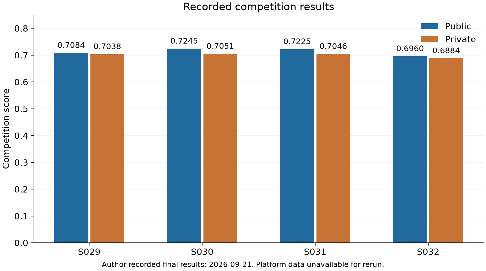
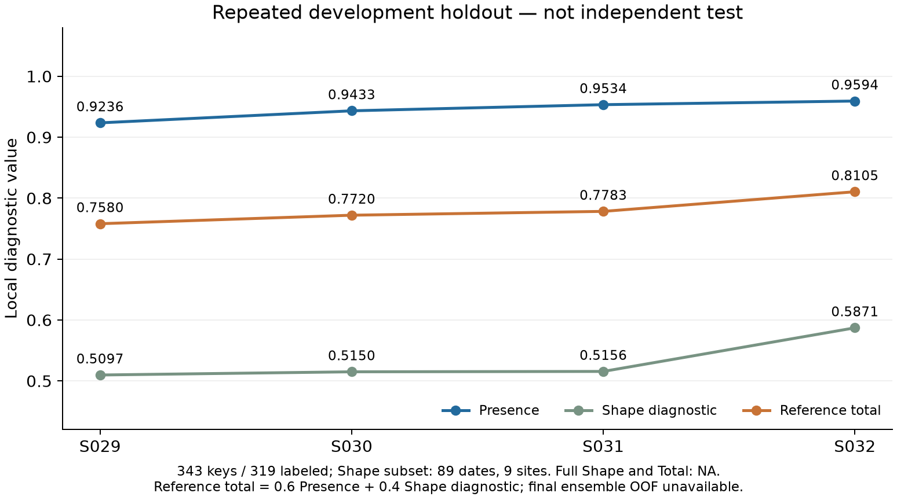

# 결과와 오류 분석

[README](../README.md) · [집계 원자료](results_summary.json) · [재현 범위](reproduction.md)

## 평가 단위와 산식

Presence는 최종 유효 polygon이 있는지를 기준으로 계산한 양성·음성 F1의 평균입니다.

```text
Presence = 0.5 × [2TP/(2TP+FP+FN) + 2TN/(2TN+FP+FN)]
Shape = 대상 날짜의 연속 polygon IoU를 사이트 안에서 평균한 뒤 사이트별 균등 평균
Total = 0.6 × Presence + 0.4 × Shape
참고종합 = 0.6 × Presence + 0.4 × Shape 진단
```

Shape의 대상은 visible이고 유효 GT 면적이 10px² 이상인 날짜입니다. 작은 양성도 Presence 평가에는 남습니다. 미라벨·ignore는 감독 평가에서 제외합니다. 무효 양성 GT가 있으면 전체 Shape와 Total은 NA로 두고 계산 가능한 부분집합의 Shape 진단을 별도로 기록합니다. 참고종합은 이 진단값을 넣은 로컬 비교값이며 플랫폼 점수와 같은 평가가 아닙니다. 로컬 scorer는 `scorer-doc-v1`입니다.

## 대회 Public·Private

대회 참가자가 2026-09-21에 기록한 최종 결과입니다. Public 29위, Private 12위, 참가 81팀으로 기록돼 있습니다. 아래 값의 출처는 이 기록이며 플랫폼 성분별 점수와 개별 예측은 확보하지 못했습니다. 아래 표에는 최종 방법과 대표 비교에 해당하는 네 제출의 기록만 담았습니다.

| 제출 | Public | Private |
|---|---:|---:|
| 역할 분리 전(S029) | 0.7083913608 | 0.7037690946 |
| 최종 구성(S030) | 0.7244646681 | 0.7051403543 |
| 단일 Presence 비교(S031) | 0.7224851498 | 0.7046090122 |
| 전체 재학습 비교(S032) | 0.6959616782 | 0.6883921898 |

역할 분리 전 구성(S029)은 면적 비율 모델(E090/A) 3개의 segmentation과 Presence를 모두 평균합니다. 최종 구성(S030)은 같은 segmentation에 9회 비교 학습에서 얻은 기준 모델(E086/baseline) 3개의 Presence를 결합합니다. 단일 Presence 비교(S031)는 RGBNIR+사전 영역+NDVI와 학습 전용 정규화로 학습한 단일 모델(S011)의 Presence를 사용합니다. 전체 재학습 비교(S032)는 학습 12개 지역을 다시 적합한 두 역할 모델입니다. S031·S032는 비교 결과만 제공하며 전체 구현을 공개 범위에 넣지 않았습니다.



S030−S029의 Public 변화는 +0.0160733073, Private 변화는 +0.0013712597입니다. 최종 Private는 종료 후 기록한 결과이며 당시 후보 선택 근거로 소급하지 않습니다. 플랫폼 성분별 점수나 개별 예측이 없으므로 어떤 오류가 Private 차이를 만들었는지는 확인할 수 없습니다.

## 반복 개발 holdout

원 학습과 분리한 3개 지역의 343키 중 감독 319건을 사용했습니다. 양성 120건·음성 199건·미라벨 24건, Shape 진단 89날짜·9사이트, 작은 양성 29건·무효 GT 2건입니다. 각 제출 당시 저장한 결과이며 현재 코드의 재학습·재추론 결과가 아닙니다. 전체 Shape와 Total은 모두 NA입니다.

| 제출 | Presence | Shape 진단 | 참고종합 |
|---|---:|---:|---:|
| 역할 분리 전(S029) | 0.923560973 | 0.509741585 | 0.758033218 |
| 최종 구성(S030) | 0.943319711 | 0.515001951 | 0.771992607 |
| 단일 Presence 비교(S031) | 0.953397612 | 0.515604333 | 0.778280301 |
| 전체 재학습 비교(S032) | 0.959359606 | 0.587149010 | 0.810475367 |




S030은 S029보다 참고종합이 +0.013959389 높았습니다. FP 13→9는 기존 FP 5건 해소·신규 1건, FN 10→8은 2건 해소·신규 0건으로 나뉩니다. 작은 양성 FN 6건은 그대로였습니다. 이는 Presence 역할 교체에 관한 관측이며 경계 자체의 개선으로 해석하지 않습니다. 당시 S029 MPS 캐시와 S030 CPU 캐시의 segmentation 확률 최대 차이는 약 1.19e-6이므로 장치 간 비트 단위 일치를 주장하지 않습니다.


그림의 왼쪽은 로컬 참고종합, 오른쪽은 플랫폼 점수입니다. 서로 다른 평가 집합이므로 패널 간 점수 크기를 직접 비교하지 않습니다.

S032의 참고종합은 S030보다 약 +0.038483 높았지만 Public은 −0.0285029899, Private는 −0.0167481645 낮았습니다. 반복 사용한 holdout의 개선이 플랫폼에서도 유지되지 않은 사례입니다. 이 비교만으로 지역 분포 차이와 반복 선택의 영향을 분리할 수는 없습니다.

## 구성 모델의 outer OOF 비교

원 학습 12개 지역에서 기준 모델(E086/baseline), 면적 비율 모델(E090/A), 사이트별 Dice 가중치 모델(E091/B)을 같은 학습·내부 선택·outer 분할로 비교했습니다. 세 방법×3개 fold의 총 9회 비교 학습 결과입니다. pooled outer 평가는 1,348키·감독 1,282건·Shape 진단 381날짜·33사이트·작은 양성 140건·무효 GT 1건입니다. 전체 Shape와 Total은 NA이며 표의 종합은 참고값입니다.

| 구성 모델 | Presence | Shape 진단 | 참고종합 | 기준 대비 | FP | FN | 작은 FN/140 |
|---|---:|---:|---:|---:|---:|---:|---:|
| 기준 모델(E086/baseline) | 0.810612202 | 0.528286291 | 0.697681837 | — | 114 | 120 | 41 |
| 면적 비율 모델(E090/A) | 0.814076841 | 0.548139285 | 0.707701818 | +0.010019981 | 114 | 116 | 41 |
| 사이트별 Dice 가중치 모델(E091/B) | 0.798971059 | 0.533191116 | 0.692659082 | −0.005022755 | 141 | 110 | 35 |

A는 BCE에 면적 비율 정답을 사용하고 binary Dice는 유지한 비교입니다. 참고종합은 3개 fold 모두, Shape 진단은 2개 fold에서 개선됐습니다. Shape 이득의 약 69.6%는 평가 날짜가 하나인 사이트의 새 검출에서 나왔습니다. 그 사이트를 제외한 32개 사이트의 평균 변화도 +0.006223796이었으나 전반적인 경계 개선으로 확대 해석하지 않습니다. 작은 FN은 7건 회복·7건 신규로 총 41건을 유지했습니다.

B는 사이트별 Dice 가중치를 적용한 비교입니다. 작은 FN이 41→35로 줄었지만 FP가 114→141로 늘어 참고종합은 낮아졌습니다. 가중치가 특정 오탐의 직접 원인이라는 인과관계는 확인하지 못했습니다. B는 대표 비개선 결과로 남겼고 최종 S030에 사용하지 않았습니다.

각 outer 표본은 해당 fold의 학습·선택에서 제외됐습니다. 다만 이 지역들은 이전 개발에서 사용됐으므로 미사용 독립 test는 아닙니다. 이 표를 **최종 6개 모델 앙상블의 OOF 성능으로 대신할 수 없습니다.** 최종 앙상블 자체의 독립 OOF는 없습니다.

## 후속 모델의 집계 비교

최종 모델(S030)과 학습 지역 확장 모델(E121)의 저장 출력을 같은 반복 개발 holdout에서 비교한 2026-09-20 기록입니다. 비교 모델은 fold별 학습 지역을 6개에서 8개로 늘려 얻은 두 역할의 모델 6개를 결합했습니다. 학습 지역, 정규화, 학습량과 선택 방식이 함께 바뀌었으므로 지역 수만의 효과로 해석하지 않습니다. 학습 지역 확장 모델은 결과 요약만 제공하며 학습 코드는 앞의 기준·면적 비율·사이트별 Dice 가중치 비교를 제공합니다. 초기 기준선·입력·손실 비교는 [주요 실험](experiments.md)에 따로 제공합니다.

평가 범위는 앞의 holdout과 같은 343키·감독 319건·Shape 진단 89날짜/9사이트입니다. 전체 Shape·Total은 무효 GT 2건 때문에 NA이며 표의 참고종합은 `0.6×Presence + 0.4×Shape 진단`입니다.

| 조건 | Presence | Shape 진단 | 참고종합 | FP | FN | 작은 FN |
|---|---:|---:|---:|---:|---:|---:|
| 최종 구성(S030) | 0.943319711 | 0.515001951 | 0.771992607 | 9 | 8 | 6 |
| 학습 지역 확장 모델(E121) | 0.949104949 | 0.557927900 | 0.792634129 | 3 | 12 | 8 |

E121은 참고종합이 +0.020641522 높았지만 FN은 4건 늘었습니다. FP 7건 해소·1건 신규, FN 2건 회복·6건 신규로 구성됩니다. 이 로컬 비교를 대회 Public·Private 개선으로 해석하지 않습니다.

## 집계 그림과 재생성

그래프는 [results_summary.json](results_summary.json)의 저장 수치로 만들었으며 플랫폼 점수와 로컬 지표를 서로 다른 그림에 표시했습니다. 실제 영상·정답·예측을 담은 사례 그림 네 장은 [README의 오류 분석](../README.md#오류-분석)에 있습니다. 사례는 반복 개발 holdout에서 사후 선정했으며 전체 오류 빈도나 플랫폼 예측을 대표하지 않습니다. 다음 명령은 집계 그래프만 다시 그리며 사례 그림을 생성하지 않습니다. 작은 양성·hole·영상 가장자리·무효 화소 등 출력 실패 조건은 합성 검사로 확인할 수 있습니다. 합성 예시는 실제 검출 성능의 증거로 사용하지 않습니다.

```bash
python -m pip install -e '.[figures]'
python scripts/make_result_figures.py
```
